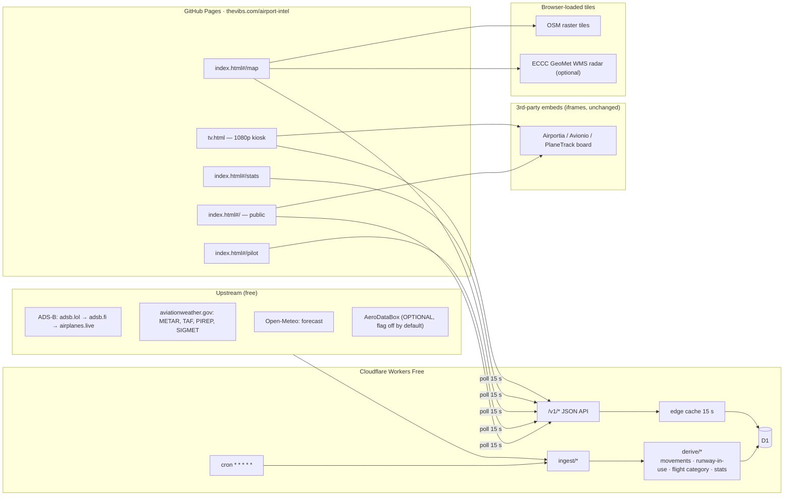

# Airport Intelligence — Architecture v2 (CYYT / YYT)

A live airport dashboard for St. John's International (CYYT/YYT). It has two audiences:

- **General public**: "Is my flight on time? What's the weather? What's that plane overhead?"
- **Pilots / flight crew**: raw + decoded METAR/TAF, flight category, crosswind per runway,
  density altitude, observed runway in use, SIGMETs/PIREPs, live traffic.

Served from `https://thevibs.com/airport-intel/`. Also runs 24/7 on a 1080p TV kiosk.

> **Safety disclaimer (must appear on every page, pilot view especially):**
> "Situational awareness only. Not an official source and not for flight planning or
> operational decisions. Use NAV CANADA official products and your dispatcher/ATC."

---

## 0. Constraints (non-negotiable)

| Rule | Detail |
|---|---|
| $0 to run | Free tiers only. No credit card anywhere. |
| Open source | Repo MIT. All libraries MIT/BSD/ISC/OFL. |
| Respect data terms | Attribution on screen. Keep embedded widgets unchanged. No scraping. |
| Browsers never call rate-limited upstream APIs | The Worker ingests; clients read our cached JSON. Exceptions: embedded widgets (iframes), map tiles, public WMS radar tiles. |
| Graceful degradation | Any single source can die. The page still renders, with that panel marked STALE. |

---

## 1. System overview



---

## 2. Feature map

| Feature | Public view | Pilot view | TV | Data source |
|---|---|---|---|---|
| Arrivals/departures board (scheduled, delays, cancellations) | ✅ | link | ✅ | Embedded widget (Airportia default; swap in config) |
| Observed movements (actual landing/takeoff times) | ✅ | ✅ | ✅ | Our ADS-B detector |
| Live map with aircraft | ✅ | ✅ | ✅ | Our ADS-B ingest + Leaflet |
| Flight track (trail + details on click) | ✅ | ✅ | trail only | Worker keeps last 15 min per aircraft |
| Plain-language weather + 24 h forecast | ✅ | — | ✅ | METAR (now) + Open-Meteo (forecast) |
| Raw + decoded METAR, TAF timeline | summary | ✅ | ✅ | aviationweather.gov |
| Flight category (VFR/MVFR/IFR/LIFR) | badge | ✅ | ✅ | Derived from METAR |
| Crosswind / headwind per runway | — | ✅ | ✅ | Derived from METAR + runway config |
| Density altitude, pressure altitude, altimeter | — | ✅ | — | Derived from METAR |
| Observed runway in use | — | ✅ | ✅ | Derived from ADS-B tracks |
| SIGMETs / PIREPs near CYYT | — | ✅ (map overlay + list) | — | aviationweather.gov |
| Weather radar overlay | toggle | toggle | optional | ECCC GeoMet WMS (verify layer) |
| Sunrise / sunset / civil twilight | ✅ | ✅ | ✅ | Computed client-side (SunCalc, BSD) |
| Stats: movements today, by hour, airlines, types, 7-day trend | ✅ | ✅ | compact | D1 rollups |
| Emergency squawk highlight (7700/7600/7500) | ✅ | ✅ | ✅ | ADS-B |
| Data health (LIVE / STALE / OFFLINE per source) | ✅ | ✅ | ✅ | `/v1/health` |

---

## 3. Data sources

| Data | Source | Endpoint | Cadence | Terms / notes |
|---|---|---|---|---|
| Aircraft (primary) | adsb.lol | `https://api.adsb.lol/v2/lat/{lat}/lon/{lon}/dist/{nm}` | 60 s | No key. ODbL, attribution. |
| Aircraft (fallback 1) | adsb.fi | `https://opendata.adsb.fi/api/v2/lat/{lat}/lon/{lon}/dist/{nm}` | on failure | Personal non-commercial; attribution + link; 1 req/s. |
| Aircraft (fallback 2) | airplanes.live | `https://api.airplanes.live/v2/point/{lat}/{lon}/{nm}` | on failure | Non-commercial; 1 req/s; no SLA. |
| METAR | aviationweather.gov | `/api/data/metar?ids=CYYT&format=json&hours=3` | 5 min | No key. 3 h history for the pressure trend. |
| TAF | aviationweather.gov | `/api/data/taf?ids=CYYT&format=json` | 10 min | No key. |
| PIREPs | aviationweather.gov | `/api/data/pirep?id=CYYT&distance=150&age=3&format=json` | 10 min | Verify param names against `/data/api/` docs. |
| Intl SIGMETs | aviationweather.gov | `/api/data/isigmet?format=json` | 10 min | Filter to CYYT bbox in Worker. Watch CPU (see §8). |
| Forecast | Open-Meteo | `/v1/forecast?latitude=47.6186&longitude=-52.7519&hourly=temperature_2m,precipitation_probability,wind_speed_10m,wind_gusts_10m,visibility,cloud_cover&timezone=America/St_Johns` | 60 min | No key, non-commercial, attribution. |
| Schedules (optional) | AeroDataBox | FIDS by local time window | quota-paced, ≤ ~20/day | Free tier; key as Worker secret; OFF by default (`FEATURE_SCHEDULE=false`). |
| Board widget | Airportia (default) / Avionio / PlaneTrack | builder snippets | provider-side | Paste unchanged, keep credit link. |
| Basemap | OSM tiles | `tile.openstreetmap.org` | browser | Attribution; low volume (fixed view). |
| Radar overlay (optional) | ECCC MSC GeoMet WMS | `https://geo.weather.gc.ca/geomet` | browser, 6 min | Open Government Licence – Canada. Verify layer name (e.g. `RADAR_1KM_RRAI`) with GetCapabilities before use. |
| Airline names | OpenFlights `airlines.dat` | bundled JSON | build | ODbL. |

All three ADS-B sources use the ADSBExchange v2 schema, so one `normalizeAdsbV2()` parses
all of them. Every upstream fetch sends `User-Agent: airport-intel/1.0 (+https://thevibs.com/airport-intel; contact: <CONTACT_EMAIL>)`.
`CONTACT_EMAIL` is a Worker var set by the owner in `wrangler.toml` `[vars]` or as a secret, never hard-coded.

**Known limits (show them in the UI, don't hide them):**
- Observed movements depend on local ADS-B receiver coverage. Low-altitude coverage at CYYT
  may be thin, so each movement carries a `confidence` of `HIGH` or `LOW`.
- ADS-B routes and origins are community-sourced. Label them "unverified".
- The flight category uses the US FAA convention (Canada doesn't publish one). Label it as such.

---

## 4. Backend — Cloudflare Worker

### 4.1 Repo layout
```
worker/
  wrangler.toml
  migrations/
    0001_init.sql
    0002_stats.sql
    0003_schedule.sql            # only applied if FEATURE_SCHEDULE
  src/
    index.ts                     # fetch() → api/router ; scheduled() → jobs/dispatch
    config.ts                    # airport, runways, thresholds, feature flags
    types.ts                     # shared response types
    jobs/
      dispatch.ts                # minute-based branching (one cron)
    ingest/
      adsb.ts                    # fetchWithFallback → raw
      metar.ts  taf.ts  pirep.ts  sigmet.ts  forecast.ts
      schedule.ts                # optional, quota-guarded
    normalize/
      adsbV2.ts                  # raw → Aircraft[]
      metar.ts                   # api JSON → Metar (units normalized)
      taf.ts                     # api JSON → TafPeriod[]
    derive/                      # PURE FUNCTIONS ONLY
      movements.ts               # tracks + aircraft → {tracks, events}
      trails.ts                  # append/trim per-aircraft trail (15 min, ≤ 16 pts)
      runwayInUse.ts             # recent low-alt tracks → {runway, confidence}
      flightCategory.ts          # Metar → VFR|MVFR|IFR|LIFR
      wind.ts                    # Metar + runways → [{rwy, headwindKt, crosswindKt, side}]
      densityAltitude.ts         # Metar + elev → {pressureAltFt, densityAltFt}
      pressureTrend.ts           # Metar[] (3 h) → {deltaHpa, trend}
      squawk.ts                  # code → null | {kind:'EMERGENCY'|'RADIO_FAIL'|'SPECIAL_7500'}
      stats.ts                   # movements → hourly/day rollups
      match.ts                   # optional: schedule ↔ movements → status/delay
    store/
      d1.ts                      # typed queries, never throws to callers (returns Result)
    api/
      router.ts                  # tiny hand-written router
      handlers/*.ts              # one file per route
      cache.ts  cors.ts  errors.ts
    lib/
      http.ts  geo.ts  time.ts  units.ts
  test/
    derive/*.test.ts             # vitest, fixture-driven
    normalize/*.test.ts
    fixtures/                    # recorded real responses (commit them)
```

### 4.2 Scheduler (one cron, free plan allows 5)
```ts
// jobs/dispatch.ts
export async function dispatch(t: Date, env: Env) {
  const m = t.getUTCMinutes(), h = t.getUTCHours();
  await run('adsb', () => ingestAdsb(env, t));                 // every minute
  if (m % 5 === 0)  await run('metar', () => ingestMetar(env));
  if (m % 10 === 1) await run('taf',   () => ingestTaf(env));
  if (m % 10 === 2) await run('pirep', () => ingestPirep(env));
  if (m % 10 === 3) await run('sigmet',() => ingestSigmet(env));
  if (m === 7)      await run('forecast', () => ingestForecast(env));
  if (m === 59)     await run('stats', () => rollupHour(env, t));
  if (env.FEATURE_SCHEDULE === 'true') await run('schedule', () => maybeIngestSchedule(env, t));
  if (h === 7 && m === 30) await run('prune', () => prune(env));
}
// run(): catches errors, records {lastOkAt|lastError} into health; never rethrows.
```
Jobs are staggered so that no single invocation does more than 2 upstream fetches. That keeps
each run well under the 10 ms CPU and 50 subrequest limits.

### 4.3 Config (`config.ts`)
```ts
export const AIRPORT = {
  icao: 'CYYT', iata: 'YYT', name: "St. John's International",
  lat: 47.6186, lon: -52.7519, elevFt: 461, tz: 'America/St_Johns',
  ingestRadiusNm: 60, terminalNm: 8, finalNm: 5,
};

// TRUE headings, from an official source (Canada Flight Supplement / NAV CANADA).
// DO NOT GUESS. Tests in derive/wind.test.ts fail while any value is null.
export const RUNWAYS: { id: string; trueHdg: number | null; lengthFt: number | null }[] = [
  { id: '11', trueHdg: null, lengthFt: null }, { id: '29', trueHdg: null, lengthFt: null },
  { id: '16', trueHdg: null, lengthFt: null }, { id: '34', trueHdg: null, lengthFt: null },
];

export const DETECT = {
  lowAglFt: 2000, vsArrFpm: -300, vsDepFpm: 300,
  lostAfterSec: 180, dedupeSec: 1800, trailMinutes: 15, trailMaxPts: 16,
  runwayAlignDeg: 20,                 // track within ±20° of runway heading
};

export const PRIVACY = { hideDbFlags: ['PIA', 'LADD'] as const }; // hide privacy-program aircraft
export const FEATURES = { schedule: false, radar: true, sigmet: true };
```
Confirm the airport reference point and elevation from the same official source when filling in runways.

### 4.4 Derivations (spec for the pure functions)

**movements.ts.** Per aircraft, evaluated each minute:
- ARR/HIGH: airborne inside `terminalNm`, then `alt_baro === 'ground'`.
- ARR/LOW: last seen inside `terminalNm`, AGL < `lowAglFt`, descending, then lost for `lostAfterSec`.
- DEP/HIGH: `ground` → airborne inside `terminalNm`.
- DEP/LOW: first seen inside `terminalNm`, AGL < `lowAglFt`, climbing.
- Dedupe `(hex, kind)` within `dedupeSec`. Each event records `runway` (from `runwayInUse` alignment) when known.

**runwayInUse.ts.** Looks at aircraft in the last 20 min that were inside `finalNm` and below
1500 ft AGL. Matches each track to the runway whose true heading is within `runwayAlignDeg`.
Returns the majority runway with `{count, lastSeenAt}`. With no traffic it returns `null` (the UI
shows "No recent traffic"). Never infer the runway from wind alone.

**flightCategory.ts** (FAA convention). Ceiling = lowest BKN/OVC/VV layer:
- LIFR: ceiling < 500 ft or vis < 1 SM
- IFR: ceiling 500–999 or vis 1 to < 3 SM
- MVFR: ceiling 1000–3000 or vis 3–5 SM
- VFR: otherwise

**wind.ts.** For each runway: `θ = windDirTrue − rwyTrueHdg`,
`head = spd·cos θ`, `cross = spd·sin θ` (sign gives L/R). Compute for both
sustained wind and gusts. Variable/calm winds give `null` with a reason. METAR wind direction is
TRUE. Runway designators are MAGNETIC, which is why config holds true headings.

**densityAltitude.ts.**
`PA = elev + (1013.25 − QNH_hPa) × 27` (≈ ft/hPa) · `ISA = 15 − 2 × (PA/1000)` ·
`DA = PA + 120 × (OAT − ISA)`. Normalize altimeter units first (`normalize/metar.ts`).

**pressureTrend.ts.** Uses 3 h of METARs: Δ ≥ +1 hPa = RISING, ≤ −1 hPa = FALLING, otherwise STEADY.

**squawk.ts.** 7700 EMERGENCY (red), 7600 RADIO FAILURE (amber), 7500 shown as
"Special code 7500" (neutral wording, no speculation).

**stats.ts.** Hourly rollup into `stats_hourly`, daily view computed from that table.

### 4.5 D1 schema
```sql
-- 0001_init.sql
CREATE TABLE state (                     -- latest snapshots, one row per key
  key TEXT PRIMARY KEY,                  -- live, tracks, metar, metar_hist, taf, pirep, sigmet, forecast, health, runway
  value TEXT NOT NULL,                   -- JSON
  updated_at INTEGER NOT NULL
);
CREATE TABLE movements (
  id INTEGER PRIMARY KEY AUTOINCREMENT,
  kind TEXT NOT NULL CHECK (kind IN ('ARR','DEP')),
  hex TEXT NOT NULL, callsign TEXT, reg TEXT, type TEXT, airline TEXT,
  runway TEXT, ts INTEGER NOT NULL,
  confidence TEXT NOT NULL CHECK (confidence IN ('HIGH','LOW'))
);
CREATE INDEX idx_mov_ts ON movements(ts DESC);

-- 0002_stats.sql
CREATE TABLE stats_hourly (
  hour_ts INTEGER PRIMARY KEY,           -- start of hour, unix s
  arr INTEGER NOT NULL, dep INTEGER NOT NULL,
  by_airline TEXT NOT NULL,              -- JSON {"ACA":3,...}
  by_type TEXT NOT NULL,                 -- JSON {"DH8D":2,...}
  by_runway TEXT NOT NULL,               -- JSON {"29":5,...}
  max_aircraft_seen INTEGER NOT NULL
);

-- 0003_schedule.sql (optional)
CREATE TABLE flights (
  kind TEXT NOT NULL, flight_no TEXT NOT NULL, callsign TEXT, other_ap TEXT,
  sched_ts INTEGER NOT NULL, api_status TEXT, actual_ts INTEGER, movement_id INTEGER,
  updated_at INTEGER NOT NULL,
  PRIMARY KEY (kind, flight_no, sched_ts)
);
```
Retention: `movements` 90 days, `stats_hourly` 2 years (tiny), `flights` 14 days.

### 4.6 API (GET only, JSON, CORS: `https://thevibs.com` + `http://localhost:*`)

| Route | Payload | Cache |
|---|---|---|
| `/v1/dashboard` | `{ now, aircraft, movements(12h), weather:{metar, derived, taf, forecast}, runway, stats:{today}, health }` | 15 s |
| `/v1/aircraft` | `{ generatedAt, aircraft[] }` (incl. `trail[]` per aircraft) | 15 s |
| `/v1/aircraft/:hex` | single aircraft + trail + matched schedule (if enabled) | 15 s |
| `/v1/movements?hours=24` | `{ arrivals[], departures[] }` | 30 s |
| `/v1/weather` | `{ metar:{raw, decoded}, derived:{category, wind[], da, pa, trend}, taf:{raw, periods[]}, forecast }` | 60 s |
| `/v1/pilot` | weather + `pirep[]` + `sigmet` (GeoJSON, filtered) + `runway` | 60 s |
| `/v1/stats?days=7` | `{ today, hourly[], days[], topAirlines[], topTypes[], runwayShare }` | 300 s |
| `/v1/health` | per source `{ lastOkAt, lastError, sourceUsed }` + `db` | 15 s |

Contract: handlers **never** return 5xx for upstream or DB trouble. They return the last good
payload plus `health` describing what's stale. Response types live in `worker/src/types.ts`
and are mirrored as JSDoc typedefs in `web/js/types.js`.

---

## 5. Frontend — GitHub Pages (no build step)

Separate public repo `airport-intel` with Pages enabled. It's served at
`https://thevibs.com/airport-intel/` because the user site already uses the `thevibs.com` custom domain.

```
web/
  index.html                 # app shell + hash router
  tv.html                    # fixed 1920×1080 grid
  css/ tokens.css base.css public.css pilot.css tv.css
  js/
    config.js                # API_BASE, POLL_MS, BOARD_PROVIDER, FEATURES
    types.js                 # JSDoc typedefs mirroring worker/src/types.ts
    api.js                   # fetch + timeout + last-good cache + staleness
    router.js                # '#/', '#/pilot', '#/map', '#/stats'
    state.js                 # tiny pub/sub store; modules subscribe to slices
    views/
      public.js  pilot.js  map.js  stats.js
    components/
      board-embed.js         # provider-swappable iframe panel
      movements-table.js     # observed ARR/DEP
      weather-card.js        # plain-language now + 24 h strip
      metar-panel.js         # raw + decoded + category badge + trend
      taf-timeline.js        # periods as horizontal bars colored by category
      wind-runways.js        # runway diagram with head/crosswind per runway
      da-panel.js            # PA / DA / altimeter
      runway-in-use.js
      pirep-list.js
      aircraft-map.js        # Leaflet: aircraft, trails, rings, extended centerlines
      aircraft-detail.js     # side sheet on click
      overlays.js            # radar WMS, SIGMET polygons, PIREP markers
      stats-charts.js        # hand-rolled SVG bar/line charts (no chart lib)
      sun-times.js           # SunCalc
      status-pill.js         # LIVE / STALE / OFFLINE
      disclaimer.js
      attribution.js
    lib/
      deadReckon.js          # advance markers between 60 s updates
      units.js  time.js  dom.js
  vendor/                    # pinned copies: leaflet, suncalc (licenses included)
  data/airlines.json
```

### 5.1 Views

**Public (`#/`).** Top to bottom:
1. Header with local time, flight category badge, status pill.
2. **Flight board** (embedded widget) with "Flight data: Airportia" label and link out to FlightAware / Flightradar24.
3. **Observed right now:** last 6 landings/takeoffs with actual times. If the schedule feature is on, it also shows delay = actual − scheduled.
4. **Weather in plain words**, e.g. "Light snow, wind from the west at 25 km/h gusting 45. Visibility 3 km."
   Units: °C, km/h, km (public). Next 24 h strip from Open-Meteo.
5. Mini map with a link to the full map.
6. Today's stats: movements so far, busiest hour, top airlines.
7. Sunrise / sunset. Disclaimer. Attribution.

**Pilot (`#/pilot`).** Dense, aviation units (kt, SM/m, ft, hPa + inHg):
- METAR raw (monospace, copyable) + decoded table, observation age in minutes (red if > 70).
- Flight category badge + 3 h pressure trend.
- **Runway wind diagram:** each runway with headwind/tailwind and crosswind (L/R) for sustained and gust.
  Highlight the runway with the best headwind. Show "Observed in use: 29 (6 movements / 20 min)" separately.
- TAF raw + timeline bars colored by category, with FM/TEMPO/PROB periods.
- PA / DA / altimeter (hPa + inHg).
- PIREPs within 150 nm (age, altitude, turbulence/icing).
- SIGMETs affecting the area (list + map overlay).
- Links out: NAV CANADA CFPS (NOTAMs, GFA). We do **not** ingest NOTAMs.

**Map (`#/map`).** Full screen Leaflet:
- Aircraft icons rotated by track. Color by altitude band. Label = callsign + FL/alt.
- 15-min trails. Range rings at 5/10/25/50 nm. Extended runway centerlines (10 nm).
- Toggles: radar, SIGMETs, PIREPs, trails, labels. Filter: airborne / ground / all.
- Click an aircraft to open the detail sheet: callsign, airline, reg, type, alt, GS, VS, track,
  squawk (highlighted if special), distance/bearing from CYYT, route "unverified", trail.
- Dead reckoning between polls so motion is smooth on the TV.

**Stats (`#/stats`).** Today vs 7-day average. Movements by hour (bar). Arrivals vs departures.
Top airlines and aircraft types. Runway usage share. All charts are hand-rolled SVG (no libs).

**TV (`tv.html`).** Fixed 1920×1080 grid:
```
┌──────────────── header: CYYT · local time · VFR badge · LIVE ───────────────┐
│ MAP (aircraft + trails + rings)     │ BOARD (embed, ARR)  │ BOARD (embed, DEP)│
│              960×600                │      480×600        │      480×600      │
├────────────────┬──────────────────────┬───────────────────────────────────────┤
│ METAR raw +    │ RUNWAY WIND diagram  │ OBSERVED MOVEMENTS (last 8)           │
│ decoded + TAF  │ + runway in use      │ + today's count + sunrise/sunset      │
└────────────────┴──────────────────────┴───────────────────────────────────────┘
footer: attribution · disclaimer · last updated
```
- No interaction, cursor hidden, `location.reload()` every 6 h, 1.25× type scale.

### 5.2 Accessibility and design
- Colour is never the only signal: category badges include text (VFR, IFR).
- High contrast dark theme by default (TV + night ops). Light theme for the public page via `prefers-color-scheme`.
- Units toggle (metric/aviation) on the public page, persisted in `localStorage` (try/catch).

---

## 6. Free-tier budget (Cloudflare Workers Free)

| Resource | Limit | Estimate | Notes |
|---|---|---|---|
| Worker requests | 100,000/day | 1,440 cron + 5,760 TV + visitors | ~90k spare for visitors |
| CPU / invocation | 10 ms | ADS-B parse 1–3 ms; SIGMET filter is the riskiest | If SIGMET exceeds, drop to every 30 min or disable via flag |
| Subrequests / invocation | 50 | ≤ 4 (2 upstream + D1) | Staggered jobs |
| Cron triggers | 5 | 1 | |
| D1 rows written | 100,000/day | ~3,500 (live+tracks/min, METAR/TAF/PIREP/SIGMET, movements, hourly stats) | ~96% spare |
| D1 rows read | 5,000,000/day | < 50k (edge cache in front) | |
| AeroDataBox (optional) | ~600 units/month | quota-paced ≤ 95% | Off by default |

Since 1 Sept 2026, D1 hard-fails once a free account goes over a daily limit. `store/d1.ts`
must catch the error, the API must serve the last cached payload, and health must show `db: "quota"`.

---

## 7. Deployment
```
airport-intel/
  worker/  web/  docs/third-party-terms.md
  ARCHITECTURE.md  CLAUDE.md  BUILD_PROMPTS.md  LICENSE  README.md
  .github/workflows/
    worker.yml   # on worker/**: npm ci → test → d1 migrations apply → wrangler deploy
    pages.yml    # on web/**: upload web/ → deploy-pages
```
Secrets: `CLOUDFLARE_API_TOKEN`, `CLOUDFLARE_ACCOUNT_ID`, `CONTACT_EMAIL`, optional `AERODATABOX_KEY`
(set with `wrangler secret put`, never committed).

Kiosk URL: `https://thevibs.com/airport-intel/tv.html`.

---

## 8. Risks and mitigations

| Risk | Mitigation |
|---|---|
| Upstream ADS-B outage or rate limit | 3-source fallback; health pill; last-good payload |
| Thin low-altitude coverage at CYYT | LOW-confidence movements; UI explains; optionally host a feeder later |
| Free terms change (widgets, APIs) | `docs/third-party-terms.md` with dates; provider swap in config |
| SIGMET JSON too heavy for 10 ms CPU | Feature flag; lower cadence; bbox filter early |
| Pilots treating it as official | Disclaimer on every view; link to NAV CANADA; no NOTAM ingestion |
| Runway headings wrong | Must come from an official source; tests block nulls |
| Privacy | Hide PIA/LADD-flagged aircraft by default |
